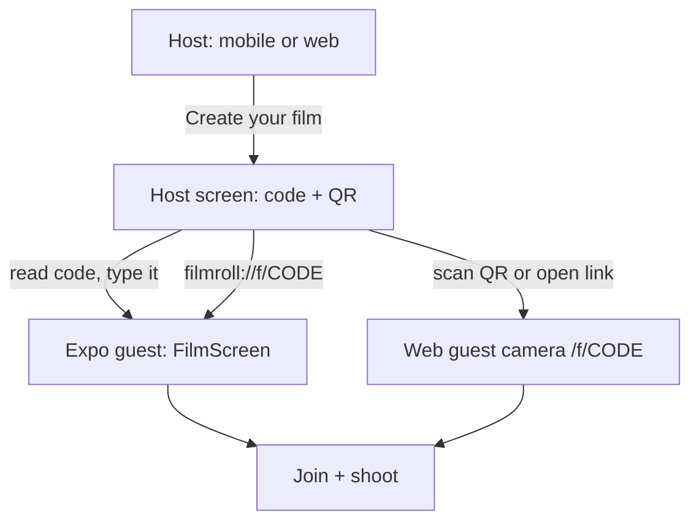

# Filmroll

A shared disposable camera for events. Guests scan a QR code, join without an
account or a download, take a limited number of photos, and the whole roll
develops at a time the host chooses.

## Quick start

### Prerequisites

- Docker Desktop (or Docker Engine + Compose v2)
- Node.js 22+ (for web and mobile)
- Ports free: **8000**, **5432**, **6379**, **9000**, **9001**, **8025**, **3000** (web dev)

### 1. Backend (Docker)

The stack lives in `backend/`. From this workspace root (targets forward there):

```bash
cp backend/.env.example backend/.env    # first time only
make up                 # builds and starts everything, waits for health
make migrate            # applies database migrations
```

| URL | Purpose |
|-----|---------|
| http://localhost:8000/docs | API + interactive docs |
| http://localhost:9001 | MinIO console (`filmroll` / `filmroll-dev-secret`) |
| http://localhost:8025 | Mailpit — magic links and host email |
| `make help` | All make targets |

Smoke test the full loop:

```bash
python3 backend/scripts/smoke.py
```

**Published ports (local):** API 8000 · Postgres 5432 · Redis 6379 · MinIO 9000/9001 · Mailpit 1025/8025

More detail: [backend/README.md](backend/README.md)

### 2. Web (host + guest PWA)

Requires the backend from step 1.

```bash
cd web
cp .env.example .env.local
npm install
npm run dev
```

Open http://localhost:3000 — create a film, open `/f/{code}` as a guest, moderate at `/f/{code}/host`.

More detail: [web/README.md](web/README.md)

### 3. Mobile (Expo — host + guest)

Requires the backend from step 1.

```bash
cd mobile
cp .env.example .env
npm install
npm start
```

Press `i` for iOS Simulator, or scan the QR with **Expo Go** on a physical phone.

**Create a film** on the home screen (Once-style), or **Join a film** with a code.

More detail: [mobile/README.md](mobile/README.md)

### Physical phone (web + Expo)

Phone and laptop on the **same wifi**. Find your address:

```bash
ipconfig getifaddr en0    # e.g. 192.168.1.42
```

Update **three** config files (replace the example IP):

| File | Keys |
|------|------|
| `backend/.env` | `S3_PUBLIC_ENDPOINT_URL=http://192.168.1.42:9000`, `PUBLIC_WEB_URL=http://192.168.1.42:3000`, add `http://192.168.1.42:3000` to `CORS_ORIGINS` |
| `web/.env.local` | `NEXT_PUBLIC_API_URL=http://192.168.1.42:8000` |
| `mobile/.env` | `EXPO_PUBLIC_API_URL=http://192.168.1.42:8000`, `EXPO_PUBLIC_WEB_URL=http://192.168.1.42:3000` |

Then `make up` from the root (reload API/workers), restart `npm run dev` in `web/`, and `npx expo start -c` in `mobile/`.

Presigned upload URLs are signed against `S3_PUBLIC_ENDPOINT_URL`. If it still
says `localhost`, join succeeds but uploads fail — the phone PUTs to itself.
Full walkthrough and troubleshooting: [mobile/README.md](mobile/README.md).

## App flow

Filmroll follows the same loop as [Once](https://once.film): **hosts create in the
native app** (or on the web), **guests join by QR or code** without downloading.



| Step | Web | Mobile (Expo) |
|------|-----|---------------|
| Create film | `/` → form → `/f/{code}/host` | **Create a film** on home screen |
| Share with guests | QR + join link on host page | QR + share on HostScreen |
| Join as guest | `/f/{code}` or scan QR | **Join a film** with code, or deep link |
| Shoot | Browser camera + IndexedDB queue | Native camera + disk queue |
| Moderate / pay (full) | `/f/{code}/host` | HostScreen: hide, develop, export, caps; paid tiers via web link |
| View developed roll | `/f/{code}/gallery` | Gallery in FilmScreen |

Scanning the host QR opens the **web PWA** by default (the QR encodes
`PUBLIC_WEB_URL`). Universal links into the native app need a signed App Store
build. Paid upgrades stay on web (Stripe) until StoreKit ships; free tier (5
guests) works from either surface.

## Architecture

```
web/       Next.js guest camera + host tools (`components/guest|host|pwa`)
mobile/    Expo host create + guest camera (`src/screens`, `src/api`)
backend/   FastAPI (`app/api`, `app/services`, `app/worker`)
```

Each of those folders is its own git repo with its own remote, and owns
everything it needs to run and be checked: README, `.env.example`, CI in
`.github/workflows/`, and a push gate in `.githooks/` (the backend also owns the
compose files, `Makefile` and `scripts/`). This workspace repo ignores all
three folders, so commit and push inside each one. It keeps only what spans
them: `ROADMAP.md`, `FEATURES.md`, `docs/`, the agent files, and a `Makefile`
that forwards to `backend/`. Skills that keep the architecture and the
existing roadmap from drifting live in `.cursor/skills/` (parent) and in
`web|mobile|backend/.cursor/skills/`. Do not start a new product plan; continue
`ROADMAP.md`.

The browser talks to FastAPI directly and uploads to storage with a presigned
URL. Next.js serves the interface and nothing else, so no photo or credential
passes through it.

The guest camera is an installable PWA. Tapping the shutter writes the JPEG to
IndexedDB first; a drain loop uploads when the network returns. Putting the
phone in airplane mode, shooting, then turning wifi back on is the intended
path, not a failure case.

The Expo app uses the same upload contract with a disk-backed queue on native.

The App Clip is not this stack: it cannot ship until a full iOS binary is on the
App Store. `GET /.well-known/apple-app-site-association` is already served so
the domain file is not the thing we scramble for later.

Hosts moderate from `/f/{code}/host`. That inbox shows photos *before* the
gallery does, which is what makes one-tap hide useful. Table cards are
`GET /v1/films/{code}/cards.pdf`. Originals export as a ZIP built on the media
worker; hidden shots are omitted.

A film starts at **5 guests, free**. Raising the cap is Stripe Checkout on the
web (`POST /v1/films/{code}/checkout`); a PATCH cannot exceed what the host has
paid for. Locally, Checkout is fake until `STRIPE_SECRET_KEY` is set, so the
host loop works without a Stripe account. The webhook is
`POST /v1/billing/webhook`. Photos are kept 12 months unless the host buys
keep-forever; the ZIP of originals stays free either way.

Save a host email on create or from the host page. Clearing the browser no
longer loses the film: `POST /v1/films/{code}/host/recover` emails a 30-minute
magic link. Local mail is Mailpit at http://localhost:8025. The morning after
a film develops, and 30 days before storage ends, the same address gets a
notice.

QR codes are generated by the API (`GET /v1/films/{code}/qr.svg`) so join URLs
never leave the system. `PUBLIC_WEB_URL` is the destination those codes encode.

Services, all defined in `backend/docker-compose.yml`:

| Service        | Role                                             |
| -------------- | ------------------------------------------------ |
| `api`          | FastAPI, presigns uploads and enforces the rules  |
| `db`           | Postgres 17, the only source of truth             |
| `redis`        | Celery broker                                     |
| `minio`        | S3-compatible storage, private bucket             |
| `worker-fast`  | Thumbnails and sweeps, high concurrency           |
| `worker-media` | ffmpeg and archives, concurrency 1                |
| `beat`         | Scheduled cleanup and notifications               |

The queues are split deliberately: a single four-minute recap encode on a shared
queue would stall hundreds of thumbnail jobs and leave every guest watching a
spinner.

## Design decisions worth keeping

**Photo bytes never pass through the API.** Clients reserve a slot, upload
directly to object storage with a presigned URL, then commit. A 150-guest
wedding is roughly 3000 photos and 15 GB; routing that through the app tier
would demand real infrastructure, and avoiding it means a small container copes.

**Reveal is derived, never a stored flag.** It is computed in SQL as
`revealed_at IS NOT NULL OR now() >= reveal_at`, using the database clock. Had a
scheduled job owned that boolean, one dead worker would mean a wedding gallery
that silently never opens. A private film still develops on that same clock;
the gallery then mints URLs only for the calling guest. The host inbox is the
couple's copy of the whole roll. Guests who joined from the app can get a push
when that happens; the host already has email.

**Caps are enforced with a row lock, not just a conditional insert.** Under
READ COMMITTED the count subquery takes no lock, so two simultaneous
reservations both observe `limit - 1` and both succeed. Since the caps are the
pricing tiers, that race gives away revenue. Reservations serialise on the guest
row, joins on the film row. Raising `guest_cap` above the paid entitlement is a
Checkout, not a PATCH; the database also checks `guest_cap <= entitled_guest_cap`.

**Shot ids come from the client.** Venue wifi guarantees retries, and a
client-generated id means every retry collapses onto the same row and the same
object instead of burning slots.

**Background work is dispatched after commit.** Redis knows nothing about
Postgres transactions, so enqueuing inline lets a worker query for a row that
was never committed.

**Photos are private by default.** The bucket denies anonymous access and images
are reachable only through short-lived signed URLs, minted after the film has
developed.

## Testing

```bash
make test        # everything
make test-fast   # excludes the load suite, used by the pre-push hook
```

Tests run against real Postgres, Redis and MinIO on a dedicated database and
bucket. SQLite is not substituted: cap enforcement is a raw conditional insert
with row locks and reveal evaluates Postgres `now()`, so an in-memory database
would exercise behaviour that does not ship.

The burst test is separate because it is slow and writes to the development
database:

```bash
./backend/scripts/loadtest.sh
```

It drives 50 guests shooting 20 photos each while sampling the API container's
memory. Throughput is the less interesting half of the output. The point is the
memory line: a recent run moved 109 MB of photos while the API peaked at 21 MiB
above idle, which is the evidence that photo bytes bypass the app tier. Add an
endpoint that proxies uploads and this is what will notice.

It runs from the host rather than inside the compose network on purpose.
Presigned URLs are signed against the public endpoint a phone would use, and
SigV4 covers the Host header, so a client that rewrites the host to reach the
internal service gets `SignatureDoesNotMatch`.

Each repo has its own push gate. Enable it once per clone, inside `backend/`,
`web/` and `mobile/`:

```bash
git config core.hooksPath .githooks
```

Pushes to `main` or `develop` then run that repo's checks: the backend suite,
web types and lint, or mobile types. The web production build is left to CI,
since it roughly triples the wait and catches little the type check does not.

This is a convenience, not a boundary: `--no-verify` bypasses it. Each repo's
`.github/workflows/test.yml` is the check to require in branch protection.

## Going to production

Storage is addressed purely through the S3 API and every dependency is a URL, so
deployment is a configuration change rather than a code change. Point
`DATABASE_URL`, `REDIS_URL` and `S3_ENDPOINT_URL` at managed services.

Cloudflare R2 is the recommended storage target, because egress dominates the
cost curve for a photo gallery and R2 does not charge for it.

Note `S3_PUBLIC_ENDPOINT_URL` is separate from `S3_ENDPOINT_URL`. Presigned URLs
are signed against a specific host and are opened by a phone, so they must be
signed for a host that phone can resolve; workers use the internal endpoint.
