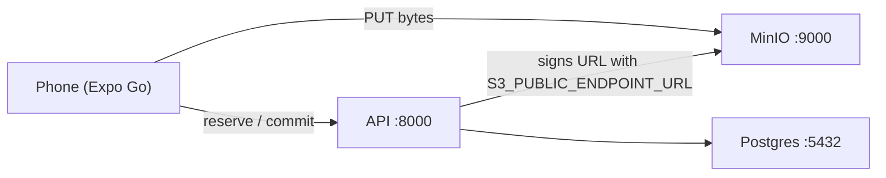

# Filmroll mobile

Expo 57 app — **hosts create and manage films here** (like Once). Guests join by code or
QR. Paid capacity upgrades use Stripe on the web until StoreKit ships.

## Prerequisites

- Node.js 22+
- A running Filmroll backend (Docker stack from the parent repo)
- **Expo Go** on your phone ([iOS](https://apps.apple.com/app/expo-go/id982107779) / [Android](https://play.google.com/store/apps/details?id=host.exp.exponent))
- Phone and computer on the **same wifi** (physical device)

## Start (iOS Simulator — localhost OK)

Backend first, from the **parent** repo:

```bash
make up && make migrate
```

Then here:

```bash
cp .env.example .env
npm install
npm start
```

Press `i` for the iOS simulator, or scan the QR code with Expo Go.

Default `.env`:

```env
EXPO_PUBLIC_API_URL=http://localhost:8000
EXPO_PUBLIC_WEB_URL=http://localhost:3000
```

`localhost` works in the simulator because it shares the Mac's network stack.

## Physical device (step by step)

This is the path most venue tests need. **Three config files** must agree — not
just `mobile/.env`.

### 1. Find your LAN address

On the machine running Docker:

```bash
ipconfig getifaddr en0    # macOS wifi, e.g. 192.168.1.42
```

Use that IP everywhere below (`192.168.1.42` is an example).

### 2. Parent `.env` (repo root)

The API signs presigned upload URLs with `S3_PUBLIC_ENDPOINT_URL`. If this stays
`http://localhost:9000`, join will work but **every upload will fail** — the
phone PUTs to itself.

```env
S3_PUBLIC_ENDPOINT_URL=http://192.168.1.42:9000
PUBLIC_WEB_URL=http://192.168.1.42:3000
CORS_ORIGINS=http://localhost:3000,http://localhost:8081,http://192.168.1.42:3000
```

(`CORS_ORIGINS` is for the browser only; native fetch ignores CORS. Include the
LAN web origin if you also test the PWA on the phone.)

Restart the stack so API and workers reload env:

```bash
make up
```

### 3. Web `.env.local` (optional but needed to create films from the phone browser)

```env
NEXT_PUBLIC_API_URL=http://192.168.1.42:8000
```

Run `npm run dev` in `web/` if you want to create a film from the phone's
browser. You can also create on the laptop at http://localhost:3000 and only
test the Expo app on the phone.

### 4. This app — `mobile/.env`

```env
EXPO_PUBLIC_API_URL=http://192.168.1.42:8000
EXPO_PUBLIC_WEB_URL=http://192.168.1.42:3000
```

Restart Expo with a clean cache (env is inlined at bundle time):

```bash
npx expo start -c
```

Scan the QR with Expo Go (Android: Expo Go app; iOS: Camera app → open in Expo).

**Expo Go must match SDK 57.** If you see *The project you requested requires a
newer version of Expo Go*, update Expo Go from the App Store (or delete and
reinstall), then scan again. No Xcode needed for that path.

**Skip Expo Go** — install a native build on a USB-connected iPhone (needs Xcode
and Apple ID signing):

```bash
npm run ios:device
# same as: npx expo run:ios --device
```

First run generates `ios/` and can take several minutes. After install, reopen
the **Filmroll** app on the phone; Metro can be started separately with
`npx expo start -c`.

### 5. Run the loop

**As host (Once-style):**

1. Open the app → **Create a film** (step 1 of 3)
2. **Your film is ready** shows the QR and code → **Share invite** (step 2)
3. **Start shooting** opens the camera as you (step 3)

**As guest:**

1. **Join a film** with the code, or open `filmroll://f/{CODE}` in a dev build
2. Join with a display name
3. Allow camera, shoot a photo
4. On your laptop, MinIO console http://localhost:9001 → bucket `filmroll-shots` → `films/{id}/originals/` should show the JPEG

You can also create a film on the web at http://localhost:3000 and join here with
the code from the host page.

### Flow

#### Host (create and share)

1. Home → **Create a film** → film name, your name, hours open (the rest under **More options**)
2. **Your film is ready** → QR (`GET /v1/films/{code}/qr.svg`), code, **Share invite**
3. **Start shooting** joins you with your saved name; your camera uses one guest seat
4. The film home has **Take photos** plus three tabs:
   - **Photos** — inbox, refreshes every 8s; Hide any shot before the gallery develops
   - **Invite** — QR, code, share
   - **Settings** — private gallery, Develop now, Export originals, Join PIN, room
     size, recovery email, **People** (co-host / photographer invites), Delete film
5. Paid tier upgrades: **Upgrade capacity on web** (Stripe until StoreKit ships)

Opening a co-host or photographer invite (`/f/{CODE}/host?seat=…`) in the app claims
it; the film home then shows only what that role can do.

#### Guest (join and shoot)



The arrow that breaks on a device is the signing one: if that setting still
says `localhost`, the phone gets a URL pointing at itself.

## Layout

```
App.tsx              deep links + home / create / host / guest routing
src/screens/         Home, CreateFilm, FilmReady, Host (film home), Film (guest), Camera
src/api/             FastAPI client + wire types (snake_case)
src/queue/           offline JPEG queue (disk first, upload later)
src/notifications.ts Expo push token after join (reveal notice)
```

Deep links: `filmroll://f/{CODE}` (guest) · `filmroll://f/{CODE}/host` (host) ·
`https://filmroll.app/f/{CODE}` when universal links are live.

## Android (emulator)

Same code as iOS. Needs Android Studio's SDK (`ANDROID_HOME`) and an emulator image.

```bash
emulator -avd <name> &          # or start one from Android Studio
adb reverse tcp:8081 tcp:8081   # emulator reaches Metro on the Mac
npm run android                 # first run generates android/ and builds (~8 min)
```

The emulator reaches the LAN IP in `.env` directly. Android-specific pieces: system
Back steps out one screen (`App.tsx`), safe areas come from
`react-native-safe-area-context`, and App Links for `https://filmroll.app/f/…` need
`ANDROID_CERT_SHA256` on the API (served at `/.well-known/assetlinks.json`). Mic and
legacy storage permissions are blocked in `app.json`; the app only takes photos.

## Release build (App Store)

`EXPO_PUBLIC_*` values are baked into the JS bundle, and a release build does not
allow plain `http` (App Transport Security). Before archiving, all three must be
public `https` hosts, not a LAN IP:

| Where | Setting |
|-------|---------|
| `mobile/.env` | `EXPO_PUBLIC_API_URL`, `EXPO_PUBLIC_WEB_URL` |
| API env | `S3_PUBLIC_ENDPOINT_URL` (uploads go straight to storage), `PUBLIC_WEB_URL` |

`app.json` carries the bundle id `app.filmroll`, `buildNumber` (bump per upload),
and `usesNonExemptEncryption: false` so App Store Connect does not ask about export
compliance each time. Signing needs an Apple Developer team that owns `app.filmroll`.

## Scripts

```bash
npm start              # Expo dev server
npm run ios            # open iOS simulator
npm run ios:device     # build + install on USB iPhone (no Expo Go)
npm run android        # open Android emulator
npm run android:device # build + install on USB Android device
npx expo start -c      # clear cache after .env change
npm run typecheck      # tsc --noEmit
```

## Troubleshooting

| Symptom | Likely cause | Fix |
|---------|----------------|-----|
| "Network request failed" on join | `EXPO_PUBLIC_API_URL` still `localhost`, or firewall blocking 8000 | Set LAN IP in `mobile/.env`; allow incoming on 8000; `npx expo start -c` |
| Join works, uploads always fail | `S3_PUBLIC_ENDPOINT_URL` still `localhost` | Set LAN IP in parent `.env`, `make up` |
| Changed `.env`, no effect | Expo inlines `EXPO_PUBLIC_*` at bundle time | `npx expo start -c` |
| iOS Simulator | — | `localhost` is fine for API and default MinIO URLs |
| Android Emulator | `localhost` is the emulator, not your Mac | Use `10.0.2.2:8000` and `10.0.2.2:9000` in env files instead of LAN IP |
| CORS error | Browser-only | Irrelevant to Expo; fix `CORS_ORIGINS` only for web PWA on phone |
| Camera permission denied | — | iOS Settings → Expo Go → Camera; or reinstall Expo Go |
| "Requires a newer version of Expo Go" | Phone Expo Go older than SDK 57 | Update Expo Go from App Store, or `npm run ios:device` |
| Xcode signing / provisioning profile errors | Apple ID not signed in or no dev profile for `app.filmroll` | Open `ios/Filmroll.xcworkspace` in Xcode → Filmroll target → Signing & Capabilities → sign in and pick a Team, then `npm run ios:device` again |

## Architecture

- `.cursor/skills/filmroll-mobile/SKILL.md`
- `.cursor/skills/filmroll-mobile/continue.md`

No App Clip or StoreKit yet. Host dashboard (moderation, reveal, export) works in-app;
paid upgrades open the web host page.
